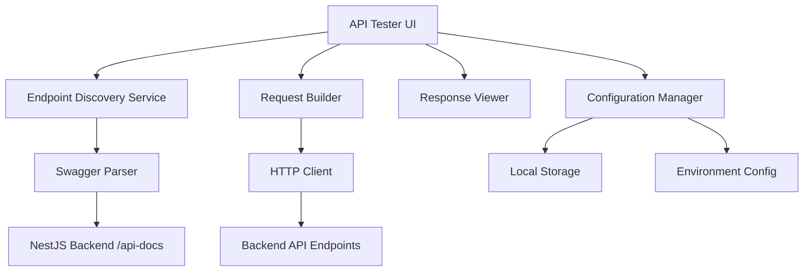

# Design Document

## Overview

The Visual API Tester is a development utility that provides a comprehensive interface for testing all API endpoints in the SynapseAI platform. Built as a Next.js frontend component, it will automatically discover and display available endpoints from the NestJS backend, allowing developers to test authentication, parameters, form data, and file uploads in a user-friendly interface.

The system leverages the existing Swagger/OpenAPI documentation from the NestJS backend to automatically populate endpoint information, reducing maintenance overhead and ensuring accuracy.

## Architecture

### High-Level Architecture



### Component Architecture

The API tester will be implemented as a standalone Next.js page with the following component structure:

- **ApiTesterPage**: Main container component
- **EndpointExplorer**: Displays categorized endpoint list
- **RequestBuilder**: Handles parameter input and request configuration
- **ResponseViewer**: Displays formatted responses with syntax highlighting
- **AuthenticationPanel**: Manages tokens and authentication
- **EnvironmentSelector**: Handles environment switching
- **SavedTestsManager**: Manages saved test configurations

## Components and Interfaces

### 1. Endpoint Discovery Service

**Purpose**: Automatically discover and parse API endpoints from Swagger documentation

**Key Methods**:
```typescript
interface EndpointDiscoveryService {
  fetchSwaggerSpec(): Promise<SwaggerSpec>
  parseEndpoints(spec: SwaggerSpec): ApiEndpoint[]
  categorizeEndpoints(endpoints: ApiEndpoint[]): EndpointCategory[]
}

interface ApiEndpoint {
  id: string
  method: HttpMethod
  path: string
  summary: string
  description?: string
  category: string
  parameters: Parameter[]
  requestBody?: RequestBodySchema
  responses: ResponseSchema[]
  security: SecurityRequirement[]
}
```

### 2. Request Builder Component

**Purpose**: Build and configure API requests with proper validation

**Key Features**:
- Dynamic form generation based on endpoint schema
- Parameter validation and type checking
- File upload handling for multipart requests
- Authentication token management

**Interface**:
```typescript
interface RequestBuilderProps {
  endpoint: ApiEndpoint
  onSendRequest: (request: ApiRequest) => void
  savedAuth: AuthConfig
}

interface ApiRequest {
  method: HttpMethod
  url: string
  headers: Record<string, string>
  body?: any
  files?: File[]
  auth?: AuthConfig
}
```

### 3. Response Viewer Component

**Purpose**: Display API responses with proper formatting and error handling

**Key Features**:
- JSON syntax highlighting with collapsible structure
- Response status and headers display
- Error message formatting
- Response time tracking

**Interface**:
```typescript
interface ResponseViewerProps {
  response: ApiResponse | null
  loading: boolean
  error?: string
}

interface ApiResponse {
  status: number
  statusText: string
  headers: Record<string, string>
  data: any
  responseTime: number
  timestamp: string
}
```

### 4. Authentication Panel

**Purpose**: Manage authentication tokens and credentials

**Key Features**:
- Bearer token input and storage
- API key management
- Environment-specific token storage
- Token validation and expiry handling

**Interface**:
```typescript
interface AuthConfig {
  type: 'bearer' | 'apikey' | 'basic'
  token?: string
  apiKey?: string
  username?: string
  password?: string
  environment: string
}
```

### 5. Environment Manager

**Purpose**: Handle multiple environment configurations

**Key Features**:
- Environment switching (dev, staging, prod)
- Base URL management per environment
- Environment-specific authentication storage

**Interface**:
```typescript
interface Environment {
  id: string
  name: string
  baseUrl: string
  description?: string
  authConfig?: AuthConfig
}
```

## Data Models

### Core Data Structures

```typescript
// Swagger/OpenAPI parsing models
interface SwaggerSpec {
  openapi: string
  info: Info
  servers: Server[]
  paths: Record<string, PathItem>
  components: Components
}

interface Parameter {
  name: string
  in: 'query' | 'path' | 'header' | 'cookie'
  required: boolean
  schema: Schema
  description?: string
  example?: any
}

interface RequestBodySchema {
  required: boolean
  content: Record<string, MediaType>
}

interface Schema {
  type: string
  format?: string
  properties?: Record<string, Schema>
  items?: Schema
  required?: string[]
  enum?: any[]
  example?: any
}

// Test configuration models
interface SavedTest {
  id: string
  name: string
  endpointId: string
  parameters: Record<string, any>
  authConfig: AuthConfig
  environment: string
  createdAt: string
  updatedAt: string
}

interface TestCollection {
  id: string
  name: string
  tests: SavedTest[]
  environment: string
}
```

## Error Handling

### Error Categories

1. **Network Errors**: Connection failures, timeouts
2. **Authentication Errors**: Invalid tokens, expired credentials
3. **Validation Errors**: Invalid parameters, malformed requests
4. **Server Errors**: 4xx and 5xx HTTP responses
5. **Parsing Errors**: Invalid Swagger spec, malformed responses

### Error Handling Strategy

```typescript
interface ErrorHandler {
  handleNetworkError(error: NetworkError): UserFriendlyError
  handleAuthError(error: AuthError): UserFriendlyError
  handleValidationError(error: ValidationError): UserFriendlyError
  handleServerError(response: ApiResponse): UserFriendlyError
}

interface UserFriendlyError {
  type: ErrorType
  message: string
  details?: string
  suggestions?: string[]
  retryable: boolean
}
```

## Testing Strategy

### Unit Testing

- **Component Testing**: Test individual React components with Jest and React Testing Library
- **Service Testing**: Test endpoint discovery, request building, and response parsing logic
- **Utility Testing**: Test authentication, validation, and formatting utilities

### Integration Testing

- **API Integration**: Test actual API calls against development backend
- **Swagger Integration**: Test Swagger spec parsing and endpoint discovery
- **Storage Integration**: Test saved configurations and environment management

### End-to-End Testing

- **User Workflows**: Test complete user journeys from endpoint selection to response viewing
- **Authentication Flows**: Test various authentication scenarios
- **Error Scenarios**: Test error handling and recovery

### Test Structure

```typescript
// Component tests
describe('RequestBuilder', () => {
  it('should generate form fields from endpoint schema')
  it('should validate required parameters')
  it('should handle file uploads correctly')
})

// Service tests
describe('EndpointDiscoveryService', () => {
  it('should parse Swagger spec correctly')
  it('should categorize endpoints by module')
  it('should handle malformed specs gracefully')
})

// Integration tests
describe('API Testing Flow', () => {
  it('should complete full request-response cycle')
  it('should handle authentication correctly')
  it('should save and load test configurations')
})
```

## Implementation Considerations

### Performance Optimizations

1. **Lazy Loading**: Load endpoint details only when selected
2. **Caching**: Cache Swagger spec and parsed endpoints
3. **Debouncing**: Debounce parameter input validation
4. **Virtual Scrolling**: Handle large numbers of endpoints efficiently

### Security Considerations

1. **Token Storage**: Store authentication tokens securely in localStorage with encryption
2. **CORS Handling**: Ensure proper CORS configuration for API testing
3. **Input Sanitization**: Sanitize all user inputs to prevent XSS
4. **Environment Isolation**: Prevent accidental cross-environment requests

### Accessibility

1. **Keyboard Navigation**: Full keyboard accessibility for all components
2. **Screen Reader Support**: Proper ARIA labels and semantic HTML
3. **Color Contrast**: Ensure sufficient contrast for syntax highlighting
4. **Focus Management**: Proper focus management for modal dialogs and forms

### Browser Compatibility

- Support for modern browsers (Chrome 90+, Firefox 88+, Safari 14+, Edge 90+)
- Progressive enhancement for older browsers
- Responsive design for mobile and tablet devices